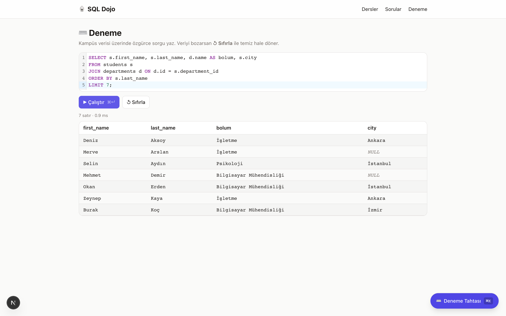
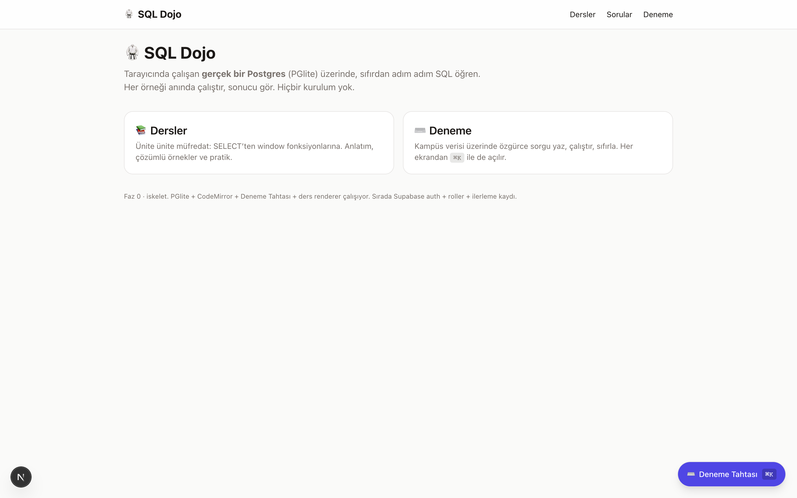
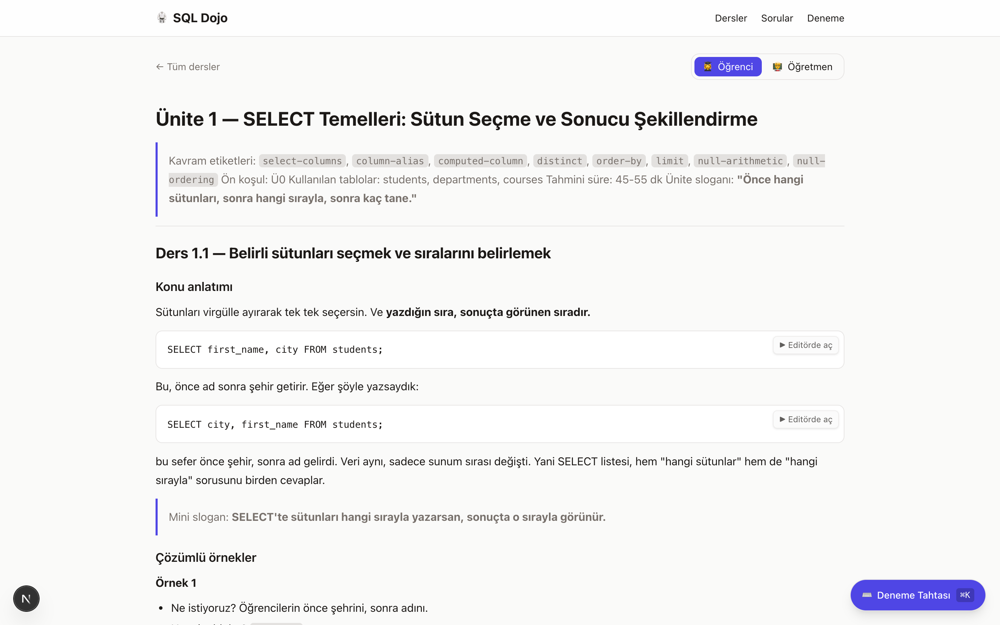
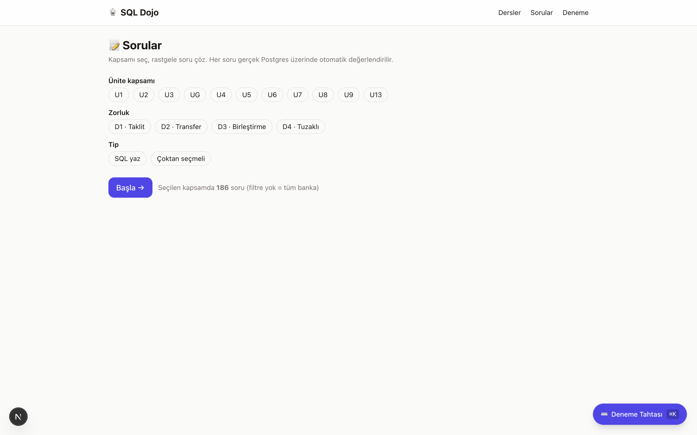
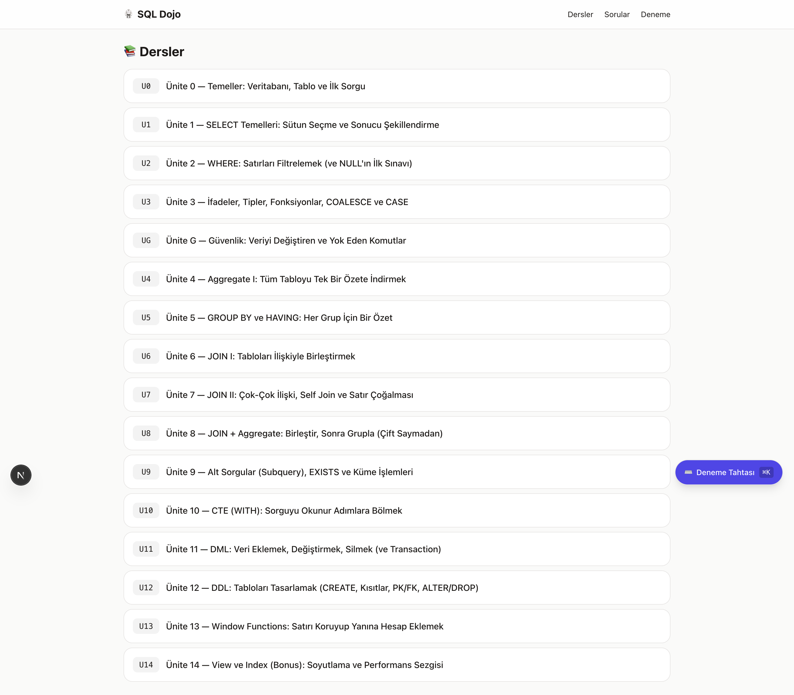

<div align="center">

# 🥋 SQL Dojo

**Tarayıcıda çalışan gerçek bir Postgres (PGlite) üzerinde, sıfırdan adım adım SQL öğreten web uygulaması.**

_An interactive SQL learning app running a real Postgres (PGlite) entirely in your browser. No setup, no server: write a query, run it, see the result instantly._

`Next.js 16` · `React 19` · `TypeScript` · `Tailwind v4` · `PGlite` · `CodeMirror 6` · `Zustand` · `Zod`



</div>

---

## At a glance

**What it is.** An interactive SQL learning web app that runs a real Postgres (PGlite) in the browser: 17 lessons, a campus sample database, a global scratchpad and an auto-checked question bank.

**Why it exists.** To teach SQL from zero with no setup or server: write a query, run it, see the result instantly (see "Ne yapar" below).

**Contents.**

| Path | What it is |
|---|---|
| `content/` | Source of truth: `lessons/` (markdown), `questions/` (question bank), `seed/` (campus seed SQL) |
| `src/` | Next.js app (`app`, `components`, `lib`, `features`) |
| `scripts/` | Content sync and smoke/QA checks (`db-smoke`, `questions-smoke`, `lesson-results-check`, `teach-order-check`, ...) |
| `docs/` | Plan, curriculum, question-bank plan, deploy notes, research, screenshots |
| `public/` | Static assets; `public/content/` is a generated copy (gitignored) |
| `.github/`, `.husky/` | CI workflow and pre-commit hook (type-check, lint, `qa:bank`) |
| `LICENSE` | MIT |

**How to run.** See "Calistirma" below: `npm install`, `npm run dev` (http://localhost:5176), `npm run check` for the full quality gate.

**Tech stack.** Next.js 16, React 19, TypeScript, Tailwind v4, PGlite, CodeMirror 6, Zustand, Zod.

**Status.** Active: last commit 2026-08-23, 29 commits since 2026-06-08. Supabase accounts and progress sync are listed as next steps in "Durum" below.

**Related repos.** None evident.

---

## Ne yapar

- 🐘 **Gerçek Postgres, tarayıcıda.** Sorgular [PGlite](https://github.com/electric-sql/pglite) (WASM Postgres) üzerinde çalışır. Kurulum yok, backend yok, anında sonuç.
- 📚 **Ünite ünite müfredat.** SELECT temellerinden window fonksiyonlarına, güvenlikten veri modellemeye 17 ders: anlatım + çözümlü örnek + pratik.
- 📝 **Otomatik değerlendirilen soru bankası.** 257 soru (17 ünite), gerçek Postgres üzerinde sonuç karşılaştırmasıyla otomatik puanlanır (SQL yaz + çoktan seçmeli). Ünite, zorluk (taklit, transfer, birleştirme, tuzaklı) ve tip filtreleri; tek tek soru akışı, kademeli ipucu, hataya özel geri bildirim.
- 🩹 **İki kademeli hata yardımı.** Editörde bir sorgu patlayınca önce gerçek Postgres hata mesajı (SQLSTATE ile) görünür; öğrenci çözemezse "Anlamadım" butonuyla anlaşılır bir "ne demek + şunu yap" açıklaması açılır.
- 📊 **İlerleme takibi.** Kaç soru çözüldü, ünite ilerlemesi ve kavram ustalığı (çalışılacak / oturmuş kavramlar) `/ilerleme` sayfasında. (Şimdilik tarayıcıda saklanır; hesap senkronu ileride.)
- ⌨️ **Deneme Tahtası.** Her ekrandan `⌘K` ile açılan global SQL paneli: kampüs verisi üzerinde özgürce dene, `↺ Sıfırla` ile temize dön.
- 🧑‍🏫 **Rol görünürlüğü.** Ders içinde 🧑‍🏫 ile işaretli bölümler sadece öğretmene görünür; öğrenci görünümünde otomatik gizlenir.

## Ekran görüntüleri

<table>
  <tr>
    <td width="50%"><br><sub><b>Ana sayfa</b>: Dersler ve Deneme</sub></td>
    <td width="50%"><br><sub><b>Ders</b>: kavram etiketleri, anlatım, çözümlü örnekler, gömülü editör</sub></td>
  </tr>
  <tr>
    <td width="50%"><br><sub><b>Sorular</b>: ünite + zorluk + tip filtreleriyle otomatik değerlendirilen banka</sub></td>
    <td width="50%"><br><sub><b>Müfredat</b>: ünite ünite ders listesi</sub></td>
  </tr>
</table>

## Çalıştırma

```bash
npm install
npm run dev        # http://localhost:5176  (predev otomatik içerik senkronu yapar)
```

| Komut | Ne yapar |
|---|---|
| `npm run build` | Production build (TypeScript kontrolü dahil) |
| `npm run check` | Tam kalite kapısı: sync + type-check + lint + db/strip/bank smoke |
| `npm run lint` | ESLint (`eslint src`) |
| `npm run type-check` | Sadece `tsc --noEmit` |
| `npm run sync:content` | `content/` -> `public/content/` kopyalar + ders `index.json` üretir |
| `npm run db:smoke` | Node'da seed'i PGlite'a yükleyip örnek sorguları doğrular |
| `npm run qa:bank` | 245 sorunun referenceSql'ini seed'e karşı doğrular (Zod + çalışma + sütun) |
| `npm run qa:lessons` | Derslerde gösterilen sonuç tablolarını seed'e karşı kontrol eder |

> Commit öncesi `husky` pre-commit hook'u `type-check + lint + qa:bank`'i otomatik çalıştırır.

## Stack

Next.js 16 (App Router) · React 19 · TypeScript · Tailwind v4 · Zustand 5 · Zod 4 · PGlite (`@electric-sql/pglite`) · CodeMirror 6 (`@uiw/react-codemirror` + `@codemirror/lang-sql`) · react-markdown + remark-gfm + rehype-raw.

## Mimari notlar

- **İki veritabanı:** Pratik sorgular tarayıcıdaki PGlite örneğinde çalışır (`src/lib/db/pglite.ts`); uygulama verisi (hesap/ilerleme) ileride Supabase'e gider. İkisi ayrıdır.
- **Tek çekirdek:** `src/components/sql/SqlRunner.tsx` (editör + Çalıştır + sonuç tablosu) playground, ders örnekleri ve Deneme Tahtası'nda aynen kullanılır.
- **Deneme Tahtası:** her ekrandan `⌘K` / floating buton ile açılan global SQL paneli (`src/features/scratchpad/`). Seed seçimi, `↺ Sıfırla`, tablolar yan paneli, sunum modu.
- **Rol-görünürlük:** ders markdown'ında başlığı 🧑‍🏫 ile başlayan bölümler öğretmene özeldir; öğrenci görünümünde `src/lib/content/strip-teacher.ts` ile çıkarılır.

## İçerik

Kaynak doğruluk `content/` altındadır (17 ders `content/lessons/*.md`, seed `content/seed/campus_seed.sql`). `public/content/` üretilmiş kopyadır (gitignore'da). Tam tasarım: `docs/PLAN.md`, `docs/CURRICULUM_MASTER.md`.

## Durum

**Çalışan:** Faz 0 iskeleti (Next 16 + PGlite + CodeMirror + Tailwind v4), 17 ders + Kampüs seed, rol-görünürlüklü ders renderer, global Deneme Tahtası (⌘K), **257 soruluk otomatik değerlendirilen Sorular modülü** (ünite/zorluk/tip filtreleri, kademeli ipucu), iki kademeli SQL hata yardımı, **`/ilerleme`** takibi ve kalite kapısı (`npm run check` + husky pre-commit). Tümü tarayıcıda doğrulandı.

**Sırada:** Supabase auth + roller + RLS (cihazlar arası ilerleme, öğretmen paneli), spaced-repetition / günlük drill, İngilizce i18n, GitHub Actions CI (`.github/workflows/ci.yml` hazır). Canlı demo: `docs/DEPLOY.md`. Tam yol haritası: `docs/PLAN.md` + `docs/QUESTION_BANK_PLAN.md`.

## Lisans

[MIT](LICENSE) © Barış Can Ateş

---

## Project Interface (standardized 2026-08-28)

**Purpose.** An interactive SQL learning app running a real Postgres (PGlite)
entirely in the browser. No setup, no server: write a query, run it, see the
result instantly. Sister project to `html-dojo`.

**Canonical path.** `/Users/bariscanates/projects/sql-dojo`
**Recovery identity.** From `recovered-projects-20260828-v1` (`working/sql-dojo`),
SHA-256 verified across 146 files. HEAD
`f988278d3b0c8af8a42d7c3032d9bc7111e045ef`, branch `main`, fsck clean.
Classification: PROVEN_REMOTE_ONLY.

### Commands
| Command | Effect |
|---|---|
| `help` / `doctor` / `status` | Info and checks, run no app code |
| `setup` | `npm ci` from the lockfile. Needs network. |
| `start` | `http://127.0.0.1:5176`; `next start` if a production build (`.next/BUILD_ID`) exists, else `next dev` |
| `stop` / `restart` / `logs` | Manage only this script's process |
| `test` | `npm run check` (lesson, content and QA validation) |

### Environment variables (names only)
None declared; no `.env.example` in the repository.

### Important directories
`app/`, `content/`, `public/`. `logs/`, `.run/` are git-ignored.

### Offline and network requirements
`setup` needs the npm registry. After that the app is fully local: PGlite runs
Postgres inside the browser, so no database server and no network are needed.

### Known gaps
- Port 5176 is the repo's own configured port; `start` refuses to run when a
  foreign process holds it and never kills one.
- No production build is committed. `start` serves dev mode until `npm run build`
  has been run once; `.next/dev/` alone is only the dev cache, not a build.
